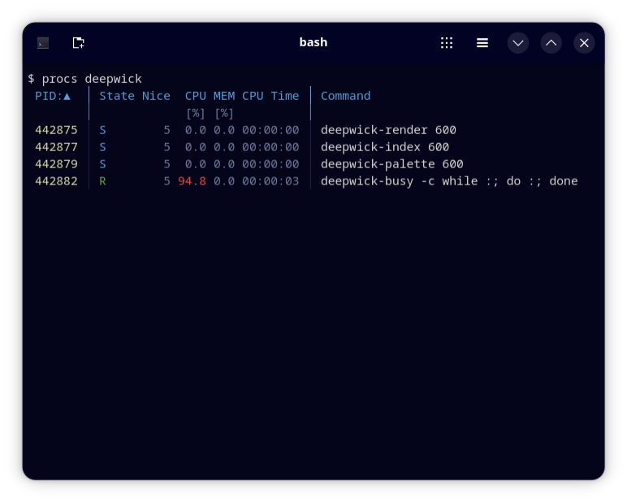

# Deepwick for procs

Deepwick colors for [procs](https://github.com/dalance/procs).

> Deepwick is an unofficial theme derived from
> [Polywick Blue](https://vscode.polywickstudio.net) by Polywick Studio (MIT).
> Not affiliated with Polywick Studio.



## Install

```sh
mkdir -p ~/.config/procs
cp deepwick.toml ~/.config/procs/config.toml
```

or keep it elsewhere and run `procs --load-config /path/to/deepwick.toml`.

If `~/.procs.toml` exists, procs reads it instead of `~/.config/procs/config.toml`.

## Notes

- procs supports only named terminal colors, not 24-bit hex colors, so this
  theme uses ANSI color slots. It looks right with a Deepwick terminal theme
  ([Ptyxis](https://github.com/deepwick/ptyxis),
  [Konsole](https://github.com/deepwick/konsole),
  [Alacritty](https://github.com/deepwick/alacritty),
  [Ghostty](https://github.com/deepwick/ghostty)).
- procs needs a complete config file, so this one also picks the columns: PID,
  state, nice, CPU, memory, CPU time and command. Add `User`, `Tty` or other
  columns from `procs --gen-config` if you want them.
- Header Blue, PIDs Yellow (Gold has no ANSI slot), CPU and memory go from
  Muted through Green, Yellow and Red. Running processes are Green and sleeping
  ones Blue.
- procs has no bold or italic.

Tested with procs 0.14.10.

## License

MIT. See [LICENSE](LICENSE).
